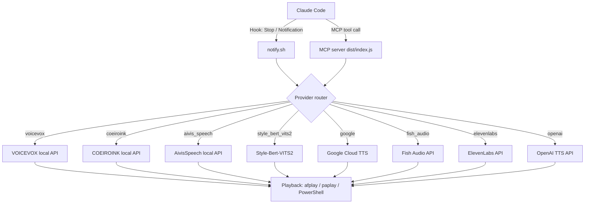

<div align="center">

<a href="./README.md"></a>
<a href="./README_ja.md"></a>

<br/><br/>


[](https://github.com/DenverCoder1/readme-typing-svg)

[](https://github.com/kubouchiyuya)
[](https://x.com/kubouchiyuya)
[](https://consulting-payment-tool.vercel.app)


</div>

---

## What This Does

`claude-voice-notify` turns Claude Code into a voice-aware workflow. It speaks when a task completes, when a confirmation is needed, or when an error appears, so you can keep moving even if you are away from the keyboard.

The default engine is VOICEVOX, which runs locally and costs nothing to use. If you want to change the sound or the provider, the repository supports eight backends and a guided setup flow for non-engineers.

---

## Why This Exists

MASA builds tools from the perspective of a salon owner who uses AI as the execution layer.

This repository is one of the interfaces in that system:

| Layer | Role |
|---|---|
| Human intent | MASA defines the outcome |
| Claude Code | Implements the work |
| Voice layer | Tells the human what happened |
| Provider layer | Selects the best TTS engine |

---

## ✨ Features

| Feature | Description |
|---|---|
| 8 providers | VOICEVOX, COEIROINK, AivisSpeech, Style-Bert-VITS2, Google TTS, Fish Audio, ElevenLabs, OpenAI |
| Local default | VOICEVOX runs locally with no API key |
| Star gate | GitHub Star verification for community access control |
| Language switch | Japanese and English notification output |
| Terminology mode | Explains technical terms in plain language |
| VS Code support | Toggle notification behavior from the editor |
| One-command update | Keep the setup current with `./update.sh` |

---

## 🚀 Quick Start

### Star First

> This tool is designed with a GitHub Star gate. Star the repo before setup.

### Setup

```bash
cd ~/Projects
git clone https://github.com/kubouchiyuya/claude-voice-notify.git
cd claude-voice-notify
./setup.sh
```

### Test

```bash
./notify.sh "Setup successful"
```

### Hooks

Add this to `~/.claude/settings.json`:

```json
{
  "hooks": {
    "Stop": [
      {
        "matcher": "",
        "hooks": [
          {
            "type": "command",
            "command": "/path/to/claude-voice-notify/notify.sh 'Task complete' complete"
          }
        ]
      }
    ],
    "Notification": [
      {
        "matcher": "",
        "hooks": [
          {
            "type": "command",
            "command": "/path/to/claude-voice-notify/notify.sh 'Please confirm' confirm"
          }
        ]
      }
    ]
  }
}
```

---

## 🏗️ Architecture



---

## 🛠️ Tech Stack


---

## 👤 Author

<div align="center">

| | |
|---|---|
| **Yuya Kubouchi (MASA2 / MASA Sub)** | Beauty Salon Owner → AI Architect |
| Location | Osaka, Japan |
| System | AKATSUKI / Miyabi Society |
| Focus | AI × Beauty Industry × Non-Engineer Operations |

*"I do not code first. I design the system, and AI executes it."*

</div>

---

<div align="center">


**If this saved you time, please give it a star.**

</div>
