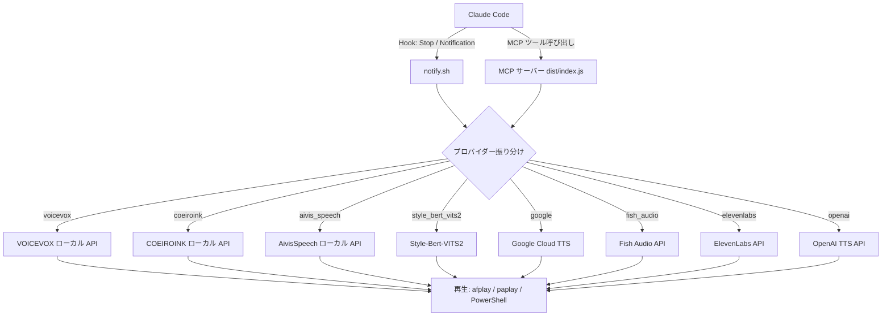

<div align="center">

<a href="./README.md"></a>
<a href="./README_ja.md"></a>

<br/><br/>


[](https://github.com/DenverCoder1/readme-typing-svg)

[](https://github.com/kubouchiyuya)
[](https://x.com/kubouchiyuya)
[](https://consulting-payment-tool.vercel.app)


</div>

---

## このツールでできること

`claude-voice-notify` は、Claude Code に「声」を持たせるための仕組みです。タスク完了、確認待ち、エラー発生を音声で伝えるので、キーボードの前にいなくても状況を把握できます。

デフォルトはローカル動作の VOICEVOX。API キー不要で無料です。必要に応じて 8 種類の音声プロバイダーに切り替えられます。

---

## 何のためにあるか

MASA は、美容室オーナーとしての現場感覚を起点に、AI を実行基盤として使うための仕組みを作っています。

このリポジトリは、その中の「通知レイヤー」です。

| 層 | 役割 |
|---|---|
| 人間の意図 | MASA がゴールを決める |
| Claude Code | 実装と実行を担う |
| 音声レイヤー | 何が起きたかを伝える |
| 音声プロバイダー | 最適な読み上げ方式を選ぶ |

---

## ✨ 機能

| 機能 | 説明 |
|---|---|
| 8 プロバイダー対応 | VOICEVOX / COEIROINK / AivisSpeech / Style-Bert-VITS2 / Google TTS / Fish Audio / ElevenLabs / OpenAI |
| ローカル既定 | VOICEVOX はローカルで動作し、API キー不要 |
| スターゲート | GitHub Star で利用可否を確認 |
| 言語切り替え | 日本語 / 英語の通知に対応 |
| 用語説明モード | 専門用語を平易な言葉で説明 |
| VS Code 連携 | エディタから通知の ON/OFF を切り替え可能 |
| ワンコマンド更新 | `./update.sh` で更新を維持 |

---

## 🚀 はじめかた

### まずスターを押す

> このツールは GitHub Star を前提にした設計です。セットアップ前にスターを押してください。

### セットアップ

```bash
cd ~/Projects
git clone https://github.com/kubouchiyuya/claude-voice-notify.git
cd claude-voice-notify
./setup.sh
```

### テスト

```bash
./notify.sh "セットアップ成功"
```

### Hooks 設定

`~/.claude/settings.json` に追加します。

```json
{
  "hooks": {
    "Stop": [
      {
        "matcher": "",
        "hooks": [
          {
            "type": "command",
            "command": "/path/to/claude-voice-notify/notify.sh 'タスクが完了しました' complete"
          }
        ]
      }
    ],
    "Notification": [
      {
        "matcher": "",
        "hooks": [
          {
            "type": "command",
            "command": "/path/to/claude-voice-notify/notify.sh '確認をお願いします' confirm"
          }
        ]
      }
    ]
  }
}
```

---

## 🏗️ アーキテクチャ



---

## 🛠️ 技術スタック


---

## 👤 作者

<div align="center">

| | |
|---|---|
| **窪内裕也（MASA2 / MASA サブ）** | 美容室オーナー → AI アーキテクト |
| 拠点 | 大阪 |
| 所属 | AKATSUKI / Miyabi Society |
| 重点 | AI × 美容業界 × 非エンジニア運用 |

*"私はコードを書く人ではなく、AI が実装する仕組みを設計する人です。"*

</div>

---

<div align="center">


**時間を節約できたなら、スターで返してください。**

</div>
